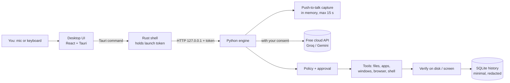

# Vico

**Speak naturally. Get things done.** Vico is a lightweight desktop voice assistant for English, Yoruba, Hausa and Igbo (Nigerian Pidgin experimental). It has two modes:

- **Agent Mode** — say or type what you want ("create a folder called Hackathon", "open bbc.com and read me the top headline", "find my project notes and open them") and Vico does it on your computer: files, apps, windows, the web browser and shell commands. Every step shows its exact effect first and waits for your approval, unless you switch approval off.
- **Interpreter Mode** — turn-based translation between two people, with the original and translated text side by side and spoken output where your computer has a voice for that language.

Vico runs on Windows 10/11 and Linux (macOS later). Heavy AI work runs on Google Gemini's free tier, using one free key per user; everything that touches your computer runs locally. No paid service is required.

> **Status:** hackathon build (v0.1.0). Language accuracy, memory use on 4 GB machines, and speech quality for Yoruba, Hausa and Igbo have **not been measured yet**. See [What is verified](#what-is-verified).

## How it works



1. You speak (push-to-talk, up to 15 s) or type. Audio stays in memory and is sent to the speech provider only if you allowed cloud processing.
2. You check and can edit the transcript before anything happens.
3. Non-English requests are translated to English; names and quoted text are kept as you said them.
4. The planner (a free-tier LLM) proposes **one step at a time** as strict JSON. It cannot run anything itself.
5. Vico validates the step (schema, allowed folders, hard limits) and shows you the exact effect. You approve or reject.
6. The step runs locally and its result is **checked** (folder exists, file content matches, window appeared, page loaded). Vico never reports success from model text alone.
7. The result feeds the next step until the task is done. A short, redacted record goes to your local history.

### Safety model

| | Approval on (default) | Approval off |
|---|---|---|
| Looking (list folder, find files, list apps/windows) | runs | runs |
| Ordinary actions (create, save, move, open, type, click, browse) | asks | runs |
| Delete (to Recycle Bin/Trash), shell commands, uploading file text | **always asks with an extra confirmation** | **always asks** |
| Sends, posts, form submissions | **always asks** | asks unless you allow it in Settings |
| Payments, typing passwords/PINs/card numbers | **never** | **never** |

Other protections: paths are resolved and checked against the folders you allow (default: your home folder), system folders are write-protected, file and web text is passed to the AI as untrusted data, at most one step per approval, a step limit per task, and Cancel works at any point. The browser Vico controls uses its own profile, separate from your everyday browser.

## Free Gemini limits

Gemini's free tier limits requests per minute and per day (the daily limit resets at midnight Pacific time, about 8–9 am in Nigeria). Vico sends requests to Gemini 3.6 Flash first and, the moment it is rate-limited, moves the same request to Gemini 3.5 Flash-Lite, so a long task keeps going without the user noticing. If both are briefly limited, Vico shows a "key cooling" countdown and resumes the task by itself. If the daily limit is used up, it stops and says when it resets. Each user's key has its own limits.

## Install (users)

Download the installer for your system from the project's Releases page:

- **Windows:** `Vico_x.y.z_x64-setup.exe` (or `.msi`). WebView2 is installed automatically if missing.
- **Linux:** `.deb` (Debian/Ubuntu), `.rpm` (Fedora) or `.AppImage`. Desktop control (typing into other apps) needs an X11 session with `xdotool` and `wmctrl`; on Wayland, files, apps, browser and shell still work.

On first launch Vico walks you through language, cloud consent, a free [Gemini access code](https://aistudio.google.com/apikey) (no card required), your workspace folder, and a self-check. Without a key Vico still works offline for simple typed English commands: `create folder Demo`, `find notes`, `open notepad`, `show files`, `save note Ideas: text`.

Browser control uses Microsoft Edge or Google Chrome if installed. Unsigned installers will trigger a Windows SmartScreen warning until code signing is set up.

## Develop

Prerequisites: Git, Node.js 20+, Rust (stable, MSVC toolchain on Windows), [uv](https://docs.astral.sh/uv/), and on Windows the Visual Studio C++ Build Tools. Linux also needs the WebKitGTK packages listed in `scripts/bootstrap_linux.sh`.

```bash
# Windows
powershell -ExecutionPolicy Bypass -File scripts/bootstrap_windows.ps1
# Linux
bash scripts/bootstrap_linux.sh
```

Then:

```bash
npm run dev          # desktop app with hot reload; the Rust shell starts the engine from services/agent/.venv
npm test             # Python, UI and Rust tests
npm run lint         # ruff
npm run typecheck    # mypy + tsc
npm run seed         # create ~/Documents/VicoDemo with synthetic demo files
npm run build        # package the engine and build installers for this OS
```

`scripts/doctor.ps1` checks a Windows machine and reports Vico's memory use while it runs.

### Repository layout

```text
apps/desktop/            React + Vite UI and the Tauri (Rust) shell
  src/components/        Agent, Interpreter, approval card, timeline, settings, history, onboarding
  src/lib/               API client, contracts (mirrors Python), hooks, speech output
  src-tauri/             Window, engine lifecycle, token-holding request proxy
services/agent/app/      Python engine
  agent/                 planner contract, policy, state machine, offline parser, prompts
  tools/                 files, apps, desktop, browser, system (shell)
  platform/              Windows / Linux / macOS adapters
  providers/             Groq, Gemini, mock; quotas, consent and fallback rules
  security/              path guards, payment/password guards, redaction, credential store
  store/                 SQLite settings and history
  audio/                 push-to-talk recorder
tests/                   unit, integration, contract fixtures, language samples
scripts/                 bootstrap, doctor, seed, build, benchmark
docs/                    build pack, implementation tasks, API contract, demo guide
```

## What is verified

| Claim | Status |
|---|---|
| Path traversal, symlink escape, reserved names, protected folders blocked | Automated tests |
| Unknown tools, extra arguments and malformed planner JSON never execute | Automated tests |
| Delete, shell and uploads always ask, even with approval off | Automated tests |
| Payment buttons, password and card fields refused | Automated tests (best-effort detection) |
| Offline typed commands work with no provider | Automated tests |
| Engine only on 127.0.0.1, token required, exits with the app | Tested on Windows 11 |
| Opening an app is verified by its window appearing | Tested on Windows 11 (Notepad) |
| UI end to end: onboarding, typed offline command, approval, verified folder | Tested in a browser against the real engine on Windows 11 |
| Packaged engine (PyInstaller folder) runs a real task | Tested on Windows 11: 22 s first start on a heavily loaded laptop, ~69 MB memory |
| Rust desktop shell compiles and launches | **Not yet on this machine** (missing MSVC Build Tools); compiled by CI |
| Speech recognition accuracy for each language | **Not measured** — run `scripts/benchmark_languages.py` with consenting speakers |
| Translation quality | **Not measured** |
| Memory and startup time on a 4 GB laptop | **Not measured** |
| Linux build and desktop control | **Not tested on a Linux machine yet** (CI builds and tests it) |

Language labels in the app stay "untested" until benchmark results exist.

## Privacy

- Push-to-talk only. No background listening. Audio never touches disk and is discarded after transcription.
- Nothing goes to a cloud provider until you allow cloud processing. Each provider's terms are linked in Settings. Google's free tier may use data to improve its products.
- During a task, text from files or web pages that Vico reads is sent to the provider to plan the next step. With approval on, you see each read first.
- API keys live in Windows Credential Manager or your Linux keyring, never in Vico's files or the UI.
- History stores a short description, tool, approval and result — not audio, file contents or full transcripts — and can be cleared.

## Licenses

Vico's own license is not chosen yet (see `LICENSE`). Third-party components are listed in [THIRD_PARTY_NOTICES.md](THIRD_PARTY_NOTICES.md).
