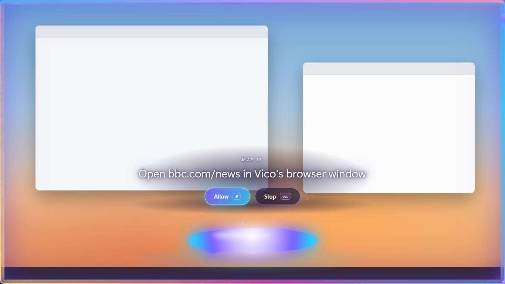
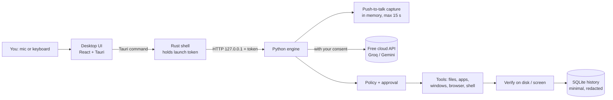

# Vico

**Speak naturally. Get things done.** Vico is an agent that operates your computer for you. Press **Win + Alt + V** (Cmd + Option + V on Mac, later), then say or type what you want in English, Yorùbá, Hausa or Igbo: "open my browser and go to bbc.com", "open settings", "create a folder called Hackathon on my desktop", "open Claude and ask it to summarise my notes". Vico works out the language by itself, does the task, and answers in your language.

There is no app window. On first run you pick how Vico appears, after watching each one play a whole task: **Peek**, **Possession**, **Yo-yo**, **Swarm** (seventy little lights), **Window runner** (a tiny character on your title bars) or **Lens** (glass that magnifies the real screen under it; on Windows through the Windows Magnification API, elsewhere clear glass, and Vico says so). Pick one, or tick several and they **take turns**, one per summon. Whatever the look, Vico acts out every step at the real place on screen: it goes to the button it clicks, the field it types into, the window it opens. Nothing darkens or covers your screen, and you can keep using your apps while Vico works. Vico lives in the system tray and puts no icon on your desktop.



Vico runs on Windows 10/11 and Linux (macOS later). Heavy AI work runs on Google Gemini's free tier, using one free key per user; everything that touches your computer runs locally. No paid service is required.

> **Status:** hackathon build (v0.1.0). Language accuracy, memory use on 4 GB machines, and speech quality for Yoruba, Hausa and Igbo have **not been measured yet**. See [What is verified](#what-is-verified).

## Using Vico

| | |
|---|---|
| Call Vico | Press **Win + Alt + V**, click the tray icon, or say anything with **"Vico"** in it ("Hey Vico", "Vico how far", "Vico, open Notepad"). (If another app owns the shortcut, Vico uses Ctrl + Alt + V; the tray menu shows which.) |
| Talk | **Hold Space** while you talk and let go when you're done; Vico never cuts you off on a pause. A quick tap does nothing. Called by name ("Vico, ..."), it waits for a 3.5-second pause instead (or press Enter). It shows what it heard, then goes. After a task it never listens by itself: hold Space again for the next request. |
| Type instead | Just start typing. |
| Stop | **Win + Alt + X** (or Ctrl + Alt + X), the tray's **Stop what Vico is doing**, or say **"Vico, stop"**: every task stops at once, including a command in the middle of running. |
| Talk to Vico itself | "Stay on the screen (until I say so)" (it stays and dozes until called), "you can go", "move to the left / top corner / out of my way", "put your label at the bottom" (Possession), "talk to me" / "just text" (spoken replies on or off; text by default). Any wording, in any of the four languages; talking as part of a task ("talk to my friend on WhatsApp") is a task. Drag a look by its handle: Peek's hands, the yo-yo's anchor, Possession's label, the swarm's nest, the runner, the Lens. It slides aside when your mouse slows down near it. |
| What it can do | Open any installed app (Store apps such as Claude and WhatsApp included), files and folders, websites; type, press keys and click in any app; volume, brightness and music keys; copy and paste between apps; screenshots of the screen, a window, half the screen, a pixel area or an area you drag, saved to Pictures/Vico Screenshots; email drafts with attachments (Thunderbird, Outlook or your mail app, or Gmail in Vico's browser); see your screen to explain what you are looking at or do it for you; research on the web without opening your browser. |
| Asking you | When something is unclear, can't be found, or fails, Vico asks you (aloud if it is talking to you) and continues with your answer, spoken or typed. "Never mind" stops. It never opens a different app than the one you named: it asks "did you mean ...?" instead. CAPTCHAs ("I'm not a robot") are for you: Vico pauses and continues when you say it's done. |
| Approve | With **Ask me before acting** on: **Enter** to allow, **Esc** to stop; risky steps (delete, commands, uploads, sends) need **Enter held down**. With it off, Vico never asks, except a delete, send or command right after it read a web page or file in the same task (such text could be written to trick it). Payments and passwords are never done either way. Deleted files go to the Recycle Bin / Trash. |
| Leave | **Esc** at any time. A running task is cancelled. |
| Settings | There is no settings button. Ask Vico to **open its settings**, by voice or typing ("open your settings", "change my key", "change your look", "open your settings make I change am"); plain "open settings" opens the computer's Settings. There: your looks, the Gemini code, an optional Groq code, more optional backup codes (Mistral, OpenRouter, TinyFish), "ask me before acting", the wake word, your speech server, and **Remove my codes and start over**. The settings panel can be minimised (keeping what you typed) or closed. Vico starts when you sign in; untick it in the tray menu. |

## How it works



1. You speak (up to 15 s, ends on a pause) or type. Audio stays in memory and is sent to the speech provider only after you set up a code and accepted the one-line disclosure.
2. You see what Vico heard and can change it before anything happens.
3. Vico detects the language: plain English is recognised on the laptop; anything else is translated to English in one call, keeping names and quoted text exactly as you said them.
4. The planner (a free-tier LLM) proposes **one step at a time** as strict JSON. It cannot run anything itself.
5. Vico validates the step (schema, allowed folders, hard limits) and shows you the exact effect. You approve or reject.
6. The step runs locally and its result is **checked** (folder exists, file content matches, window appeared, page loaded). Vico never reports success from model text alone.
7. The result feeds the next step until the task is done. A short, redacted record goes to your local history.

### Safety model

| | Approval on (default) | Approval off |
|---|---|---|
| Looking (list folder, find files, list apps/windows) | runs | runs |
| Ordinary actions (create, save, move, open, type, click, browse) | asks | runs |
| Delete (to Recycle Bin/Trash), shell commands, uploading file text | **always asks with an extra confirmation** | **always asks** |
| Sends, posts, form submissions | **always asks** | asks unless you allow it in Settings |
| Payments, typing passwords/PINs/card numbers | **never** | **never** |

Other protections: paths are resolved and checked against the folders you allow (default: your home folder), system folders are write-protected, file and web text is passed to the AI as untrusted data, at most one step per approval, a step limit per task, and Cancel works at any point. The browser Vico controls uses its own profile, separate from your everyday browser.

## Speed

Measured on this Windows laptop with the real engine and a free Gemini key (median of 3, from request to finished):

| Request | Before | After | AI calls |
|---|---|---|---|
| Typed "open notepad" | 16.4 s | 2.3 s | 2 → 0: an exact simple command runs on the computer |
| One step, English ("list the files in my Documents folder") | 7.9–9.4 s | 2.7 s | 2 → 1: the step is marked final |
| One step, Yorùbá (same request) | 12.8 s | 3.9 s | 4–5 → 1: the planner reads Yorùbá directly and answers in it |
| Three steps (two folders, then list them) | 17.7 s | 11.1 s | 4 → 3 |

Also: the app waits for each change instead of polling, the AI connection is warmed when Vico is summoned or
woken, the app list is scanned once at start, the engine itself hears when you stop speaking, and the avatar
reacts before any network call returns. Approvals, safety checks and verification are unchanged.

## Without Gemini

Gemini is the first choice, never the only one:

| Job | In order |
|---|---|
| Understanding and answers | Gemini, Groq (free gpt-oss / Qwen models), Mistral (Free plan), OpenRouter (free models) |
| Hearing you | Gemini, your own speech server (NaijaVox-2.0 or Meta Omnilingual), Groq Whisper (every language), Mistral Voxtral (English). A provider slower than 5 s gets the next one started alongside it |
| Speaking | Gemini TTS (English, Hausa, Igbo, Pidgin with an English voice), your speech server (YarnGPT: Yorùbá too), the computer's own voice (English, offline) |
| Web research | Keyless search engines, TinyFish (optional code), Gemini's Google Search, then the AI's own knowledge (labelled) |

Recordings are cleaned first (rumble filter, background-noise reduction in noisy rooms, silence trimmed, quiet voices raised), and the names of your installed apps and open windows go with them as spelling hints, so "Claude" is not heard as "cloud".

## Free Gemini limits

Gemini's free tier limits requests per minute and per day (the daily limit resets at midnight Pacific time, about 8–9 am in Nigeria). Vico sends requests to Gemini 3.6 Flash first and, the moment it is rate-limited, moves the same request to Gemini 3.5 Flash-Lite, so a long task keeps going without the user noticing. If both are briefly limited, Vico shows a "key cooling" countdown and resumes the task by itself. If the daily limit is used up, it stops and says when it resets. Each user's key has its own limits.

## Better Nigerian-language speech (optional, free)

Run the free, self-hosted **Vico Speech Server** (`services/speech_server`, Linux) to add:

- **Meta Omnilingual ASR** (Apache-2.0) as the speech fallback for Yorùbá, Hausa and Igbo. Speech order: Gemini → Omnilingual → Groq Whisper, which Vico now uses for **English only**: it is weak on Yoruba and Hausa and does not support Igbo.
- **YarnGPT** Nigerian voices (Apache-2.0) so Vico answers aloud in your language.

Models download only from the publishers' official repositories at pinned commits, with checksums verified. Typed Yorùbá and Igbo without tone marks are restored automatically ("Se folda tuntun" → "Ṣe fóldà tuntun") in the same AI call that detects the language; Vico accepts the result only if nothing but the accents changed. Accuracy and speed on the free Oracle server are **not measured yet**; see the server's README for how to measure them.

## Install (users)

Download the installer for your system from the project's Releases page:

- **Windows:** `Vico_x.y.z_x64-setup.exe` (or `.msi`). WebView2 is installed automatically if missing.
- **Linux:** `.deb` (Debian/Ubuntu), `.rpm` (Fedora) or `.AppImage`. Desktop control (typing into other apps) needs an X11 session with `xdotool` and `wmctrl`; on Wayland, files, apps, browser and shell still work. The see-through overlay needs a compositing desktop (GNOME, KDE and most others).

On first launch Vico asks for one thing: a free [Gemini access code](https://aistudio.google.com/apikey) (no card required). An optional Groq code is used automatically whenever Gemini is busy. Without a key Vico still works offline for simple typed English commands: `create folder Demo`, `find notes`, `open notepad`, `show files`, `save note Ideas: text`.

Browser control uses Microsoft Edge or Google Chrome if installed. Unsigned installers will trigger a Windows SmartScreen warning until code signing is set up.

## Develop

People who only use Vico never compile anything: installers are built on GitHub's machines (push a tag like `v0.1.0`, see `.github/workflows/release.yml`) and appear on the Releases page.

To develop Vico, run the setup script for your system. On Windows it installs anything missing (Git, Node.js, uv, Rust, and Microsoft's C++ build tools) and pins Rust's MSVC toolchain for this repository. Tauri cannot be compiled with Rust's GNU toolchain or without the C++ build tools, and the script fixes both. On Linux it installs the WebKitGTK, audio and desktop-control packages.

```bash
# Windows
powershell -ExecutionPolicy Bypass -File scripts/bootstrap_windows.ps1
# Linux
bash scripts/bootstrap_linux.sh
```

Then:

```bash
npm run dev          # desktop app with hot reload; the Rust shell starts the engine from services/agent/.venv
# Browser preview of the whole experience with a scripted engine: npm --prefix apps/desktop run dev, then
# open http://localhost:1420/?demo=1 and press Ctrl + Alt + V
npm test             # Python, UI and Rust tests
npm run lint         # ruff
npm run typecheck    # mypy + tsc
npm run seed         # create ~/Documents/VicoDemo with synthetic demo files
npm run build        # package the engine and build installers for this OS
```

`scripts/doctor.ps1` checks a Windows machine and reports Vico's memory use while it runs.

### Repository layout

```text
apps/desktop/            React + Vite UI and the Tauri (Rust) shell
  src/views/             Looks (Peek, Possession, Yo-yo, live previews), Aura (the look over your screen), Prompt (words, approval, setup)
  src/lib/               session driver, API client, contracts (mirrors Python), window bus, demo engine
  src-tauri/             tray, global shortcut, two see-through windows, engine lifecycle, token proxy
services/agent/app/      Python engine
  agent/                 planner contract, policy, state machine, offline parser, prompts
  tools/                 files, apps, desktop, browser, system (shell)
  platform/              Windows / Linux / macOS adapters
  providers/             Groq, Gemini, mock; quotas, consent and fallback rules
  security/              path guards, payment/password guards, redaction, credential store
  store/                 SQLite settings and history
  audio/                 push-to-talk recorder
tests/                   unit, integration, contract fixtures, language samples
scripts/                 bootstrap, doctor, seed, build, benchmark
docs/                    build pack, implementation tasks, API contract, demo guide
```

## What is verified

| Claim | Status |
|---|---|
| Path traversal, symlink escape, reserved names, protected folders blocked | Automated tests |
| Unknown tools, extra arguments and malformed planner JSON never execute | Automated tests |
| Delete, shell and uploads always ask, even with approval off | Automated tests |
| Payment buttons, password and card fields refused | Automated tests (best-effort detection) |
| Offline typed commands work with no provider | Automated tests |
| Engine only on 127.0.0.1, token required, exits with the app | Tested on Windows 11 |
| Opening an app is verified by its window appearing | Tested on Windows 11 (Notepad) |
| UI end to end: onboarding, typed offline command, approval, verified folder | Tested in a browser against the real engine on Windows 11 |
| Packaged engine (PyInstaller folder) runs a real task | Tested on Windows 11: 22 s first start on a heavily loaded laptop, ~69 MB memory |
| Rust desktop shell compiles and launches | **Not yet on this machine** (missing MSVC Build Tools); compiled by CI |
| Speech recognition accuracy for each language | **Not measured** — run `scripts/benchmark_languages.py` with consenting speakers |
| Translation quality | **Not measured** |
| The three looks through a whole task (listen, think, approve, work, cool down, finish) | Captured in a browser at 1366×768 with the scripted demo; following the real foreground window is **not yet tested on a real desktop** |
| Memory and startup time on a 4 GB laptop | **Not measured** |
| Linux build and desktop control | **Not tested on a Linux machine yet** (CI builds and tests it) |

Language labels in the app stay "untested" until benchmark results exist.

## Privacy

- Spoken replies are off until you ask ("Vico, talk to me"). Then answers are spoken in your language: Gemini 3.8 TTS with your own key for English, Hausa and Igbo; Pidgin with an English voice (Pidgin is not on Gemini's language list); Yorùbá only with your own speech server (YarnGPT), since Gemini's TTS does not list Yorùbá; offline English uses the computer's own voice. Audio stays in memory. Long answers: the first sentences are spoken, the rest stays on screen.
- "Hey Vico" is recognised **on this computer** (Vosk, offline). While waiting, Vico listens only for that phrase: each slice of sound is checked and dropped, never stored or sent. Windows shows its microphone-in-use icon while this is on; turn it off in Settings. After the phrase, or when you summon Vico, your request is recorded in memory (max 15 s), sent for transcription, and discarded.
- If your default microphone is muted or delivers pure silence, Vico tries your other microphones by itself.
- Uninstalling Vico removes your saved access codes, settings and chosen look, so reinstalling starts fresh. Automatic updates keep them. On Linux, use "Remove my codes and start over" in Settings before removing the package.
- Nothing goes to a cloud provider until you allow cloud processing. Each provider's terms are linked in Settings. Google's free tier may use data to improve its products.
- During a task, text from files or web pages that Vico reads is sent to the provider to plan the next step. With approval on, you see each read first.
- Looking at the screen (look_at_screen, click_on_screen) sends a picture of your whole screen to your AI provider (Gemini). Vico does this only for a request that needs it.
- Web research sends the search words to free search engines (DuckDuckGo, Bing, Brave, Mojeek, Yahoo, through the open-source ddgs library) or to TinyFish if you added its code, and reads the result pages from this computer. Keyless search engines can refuse very frequent searches for a while; Vico then answers from what the AI knows and says it was not checked online.
- When Gemini is busy or out of free quota, requests go to the next provider you set up (Groq, Mistral, OpenRouter), each under its own terms.
- On Windows, background helpers (the app list, volume, brightness, voice, commands you ask for) run with no window popping up.
- API keys live in Windows Credential Manager or your Linux keyring, never in Vico's files or the UI.
- History stores a short description, tool, approval and result — not audio, file contents or full transcripts — and can be cleared.

## License

Vico is licensed under the [Apache License 2.0](LICENSE) (see also [NOTICE](NOTICE)). Third-party components keep their own licenses; see [THIRD_PARTY_NOTICES.md](THIRD_PARTY_NOTICES.md).
